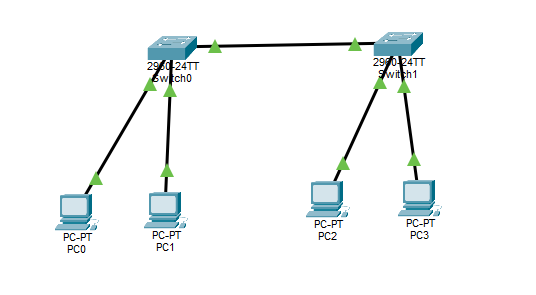
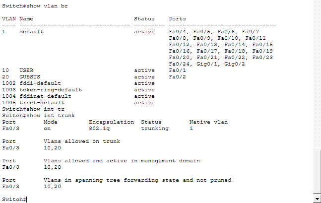
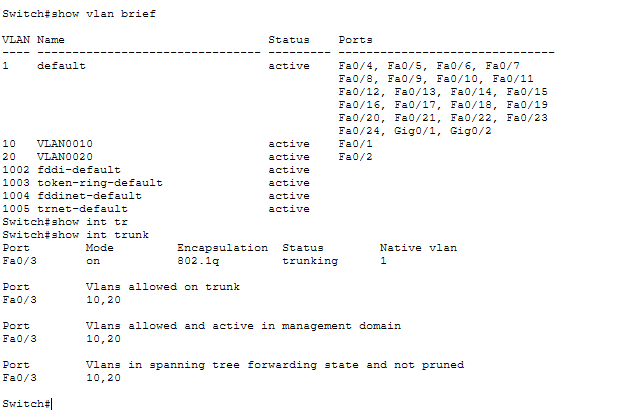
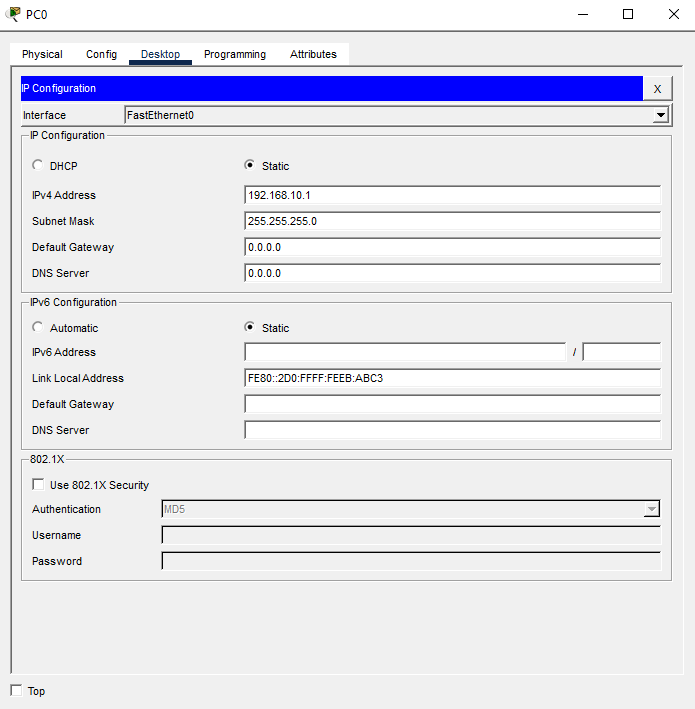
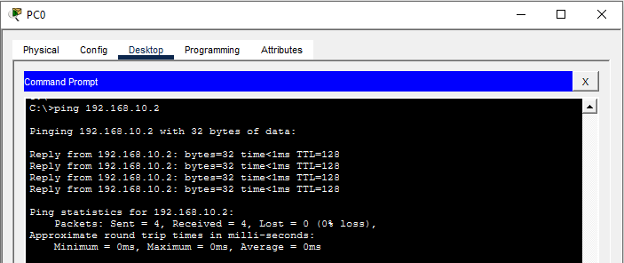
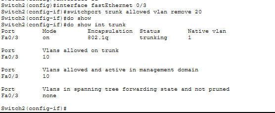
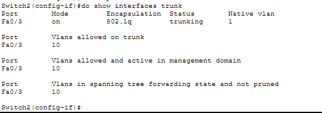
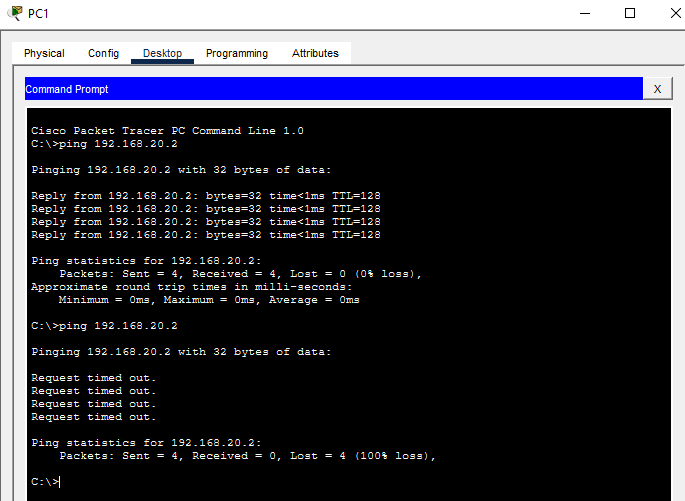

# Lab 01 — VLAN и 802.1Q Trunk

## Цель работы
Разделить локальную сеть на два изолированных широковещательных домена (VLAN 10 и VLAN 20) на базе двух коммутаторов L2 и организовать передачу трафика обоих сегментов между коммутаторами через магистральный порт (802.1Q Trunk).

## Топология и адресация



| Устройство | Интерфейс | Режим / VLAN | IP-адрес | Маска подсети |
| :--- | :--- | :--- | :--- | :--- |
| **PC1** | FastEthernet0 | Access / VLAN 10 | `192.168.10.1` | `255.255.255.0` |
| **PC2** | FastEthernet0 | Access / VLAN 20 | `192.168.20.1` | `255.255.255.0` |
| **PC3** | FastEthernet0 | Access / VLAN 10 | `192.168.10.2` | `255.255.255.0` |
| **PC4** | FastEthernet0 | Access / VLAN 20 | `192.168.20.2` | `255.255.255.0` |
| **SW1** | Fa0/1 / Fa0/2 / Fa0/3 | VLAN 10 / VLAN 20 / Trunk (10,20) | — | — |
| **SW2** | Fa0/1 / Fa0/2 / Fa0/3 | VLAN 10 / VLAN 20 / Trunk (10,20) | — | — |

## Конфигурация коммутаторов (SW1 и SW2)

```ios
enable
configure terminal
vlan 10
 name USERS
vlan 20
 name GUESTS
exit

interface fa0/1
 switchport mode access
 switchport access vlan 10
interface fa0/2
 switchport mode access
 switchport access vlan 20

interface fa0/3
 switchport mode trunk
 switchport trunk allowed vlan 10,20
end
write memory

## Проверка

| Что проверяем | Скриншот |
| :--- | :--- |
| VLAN и транк на SW1 |  |
| VLAN и транк на SW2 |  |
| Адрес PC0 |  |
| Пинг внутри VLAN 10 |  |

## Сценарий отказа: VLAN 20 убран из транка

На SW2 из разрешённых VLAN транка убрали 20-й:

```ios
interface fa0/3
 switchport trunk allowed vlan remove 20
```

Транк остаётся `trunking`, но пропускает только VLAN 10, поэтому хосты VLAN 20 на разных коммутаторах перестают видеть друг друга.





Восстановление: `switchport trunk allowed vlan add 20`.

Заметки по ходу работы: [notes.md](notes.md). Конфиги: [configs/](configs/). Файл для Packet Tracer: [topology.pkt](topology.pkt).
