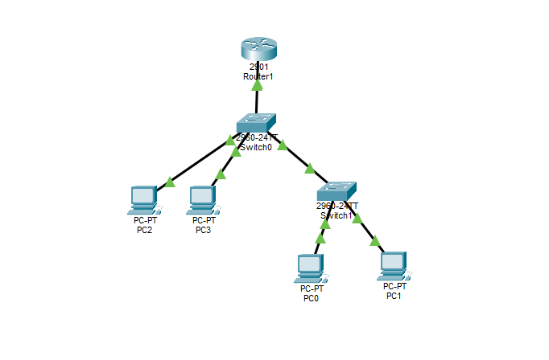
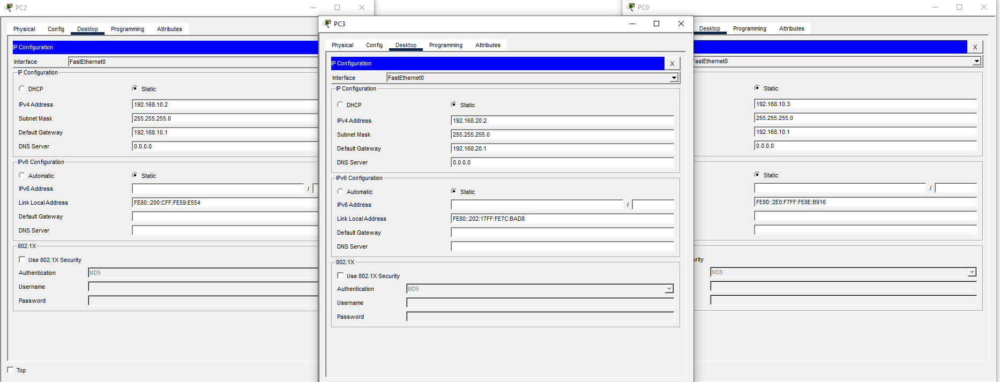
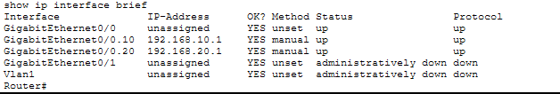
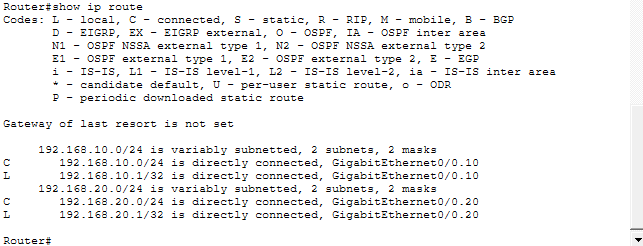
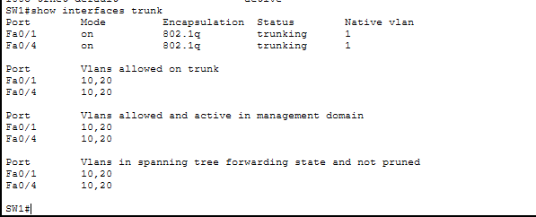
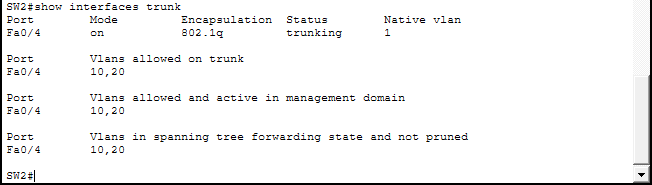
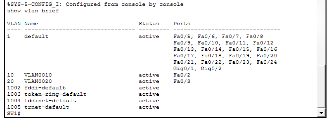
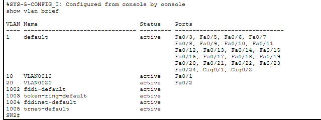
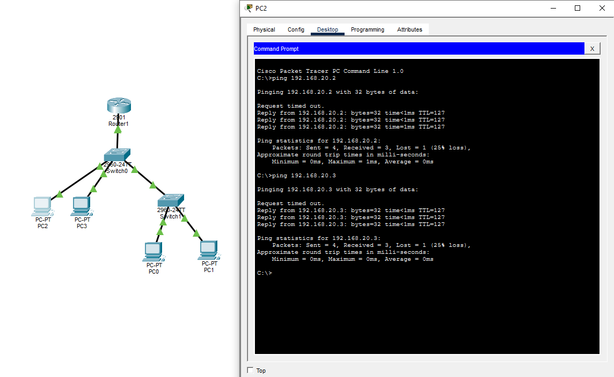

# Lab 02 — Межвлановая маршрутизация (Router-on-a-Stick)

## Цель работы
Организовать маршрутизацию трафика между двумя изолированными широковещательными доменами (VLAN 10 и VLAN 20) через один физический интерфейс маршрутизатора, разделённый на логические подинтерфейсы с инкапсуляцией 802.1Q (Router-on-a-Stick).

## Топология и адресация



| Устройство | Интерфейс | Режим / VLAN | IP-адрес | Маска подсети | Шлюз (Gateway) |
| :--- | :--- | :--- | :--- | :--- | :--- |
| **PC2** | FastEthernet0 | Access / VLAN 10 | `192.168.10.2` | `255.255.255.0` | `192.168.10.1` |
| **PC3** | FastEthernet0 | Access / VLAN 20 | `192.168.20.2` | `255.255.255.0` | `192.168.20.1` |
| **PC0** | FastEthernet0 | Access / VLAN 10 | `192.168.10.3` | `255.255.255.0` | `192.168.10.1` |
| **PC1** | FastEthernet0 | Access / VLAN 20 | `192.168.20.3` | `255.255.255.0` | `192.168.20.1` |
| **SW1** | Fa0/2 / Fa0/3 / Fa0/1 (к роутеру), Fa0/4 (к SW2) | VLAN 10 / VLAN 20 / Trunk (10,20) | — | — | — |
| **SW2** | Fa0/1 / Fa0/2 / Fa0/3 (к SW1) | VLAN 10 / VLAN 20 / Trunk (10,20) | — | — | — |
| **Router1** | Gi0/0.10 / Gi0/0.20 | Subinterface / dot1Q 10, 20 | `192.168.10.1` / `192.168.20.1` | `255.255.255.0` | — |

## Конфигурация коммутаторов

### SW1

```ios
enable
configure terminal
vlan 10
vlan 20
exit

interface fa0/2
 switchport mode access
 switchport access vlan 10
interface fa0/3
 switchport mode access
 switchport access vlan 20

! к роутеру
interface fa0/1
 switchport mode trunk
 switchport trunk allowed vlan 10,20
! к SW2
interface fa0/4
 switchport mode trunk
 switchport trunk allowed vlan 10,20
end
write memory
```

### SW2

```ios
enable
configure terminal
vlan 10
vlan 20
exit

interface fa0/1
 switchport mode access
 switchport access vlan 10
interface fa0/2
 switchport mode access
 switchport access vlan 20

! к SW1
interface fa0/3
 switchport mode trunk
 switchport trunk allowed vlan 10,20
end
write memory
```

VLAN без имён (в `show vlan brief` они видны как `VLAN0010` и `VLAN0020`).

## Конфигурация маршрутизатора (Router1)

Физический интерфейс Gi0/0 включается без IP-адреса, адреса вешаются на подинтерфейсы:

```ios
interface gi0/0
 no shutdown
interface gi0/0.10
 encapsulation dot1Q 10
 ip address 192.168.10.1 255.255.255.0
interface gi0/0.20
 encapsulation dot1Q 20
 ip address 192.168.20.1 255.255.255.0
```

Полный конфиг: [configs/Router1_running-config.txt](configs/Router1_running-config.txt).

## Проверка

| Что проверяем | Скриншот |
| :--- | :--- |
| Адреса и шлюзы на ПК |  |
| Интерфейсы маршрутизатора |  |
| Таблица маршрутизации |  |
| Транк на SW1 |  |
| Транк на SW2 |  |
| VLAN на SW1 |  |
| VLAN на SW2 |  |
| Пинг между VLAN |  |

Файл для Packet Tracer: [topology.pkt](topology.pkt).
